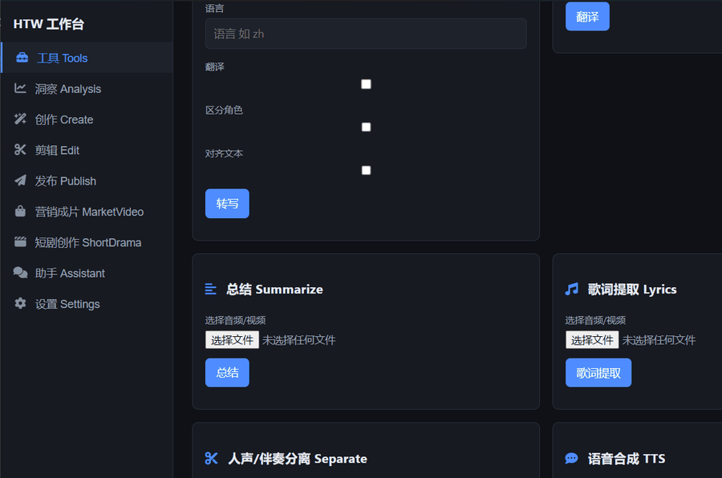
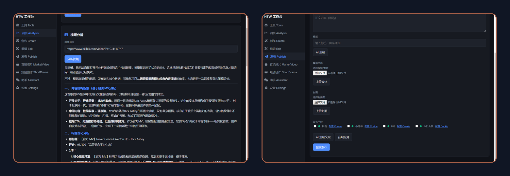

<div align="center">

# HTW Media Client 🎬

### 从「今天发什么」到「发完没」，一个工作台做完

选题没灵感、脚本写不动、剪片耗半天、发四个平台要开四个后台 ——
HTW Media Client 把 **选题 → 创作 → 剪辑 → 发布** 收进同一个桌面工作台，
重活（转写、渲染、发布）全部在服务端跑，本地只管点。

<p align="center">
  
</p>

[](https://github.com/HTWMedia/HTWClient/releases/latest)
[](https://github.com/HTWMedia/HTWClient/releases/latest)
[](https://htwmedia.dpdns.org)
[](https://www.electronjs.org/)
[](LICENSE)
[](https://github.com/HTWMedia/HTWClient/stargazers)

简体中文 ｜ [问题反馈](https://github.com/HTWMedia/HTWClient/issues) ｜ [版本发布](https://github.com/HTWMedia/HTWClient/releases) ｜ [在线体验](https://htwmedia.dpdns.org)

**关键词**：AI 短视频 · 多平台一键发布 · 自动剪辑 · 剪同款 · 选题雷达 · 热榜趋势 · 字幕提取 · Agent Skills · Electron 客户端 · 视频教程

</div>

---

## 三个让你留下来的理由

1. **全链路，不是单点工具**：洞察、选题、创作、剪辑、发布在一个工作台里闭环 —— 多数工具只解决其中一环，剩下的还是要你自己拼。
2. **重活在云端，不吃本机**：转写、渲染、发布都由服务端算力完成，老笔记本也能跑批量任务。
3. **Agent 原生**：同一套能力同时以 Agent Skills 开放，Claude Code / Cursor 之类的 AI 助手可以直接编排「查热点 → 写脚本 → 出片 → 发布」整条流水线。

---

## 界面预览 🖥️



> 🎬 以上 30 秒演示的录制分镜见 [docs/demo-script.md](docs/demo-script.md)。

左侧是 9 个能力面板，除助手外统一走 `/api/v2/*` 契约（`{ ok, data, errCode, errMsg, taskId }`）：



---

## 📺 视频教程（11 集 · 约 14 分钟）

每个功能一集：功能介绍 + 真实操作过程 + 结果展示 + 提示说明，中文配音与烧录字幕，云端渲染等待段已加速并标注。
也可以在 B 站合集里一口气看完（弹幕 / 评论 / 追更）：[HTW 工作台全流程教程](https://www.bilibili.com/video/BV1ddxm68Edo)。

| # | 视频 | 时长 | 看点 |
|---|---|---|---|
| 01 | [安装与初始配置](https://github.com/HTWMedia/HTWClient/releases/download/v0.5.0/01-setup.mp4) | 1:59 | AuthKey 配置（**必看**）、本地模式 |
| 02 | [剪辑 · 视频粗剪](https://github.com/HTWMedia/HTWClient/releases/download/v0.5.0/02-coarse-cut.mp4) | 2:28 | 带口播的长视频 → 自动剪出带配音字幕的成片 |
| 03 | [剪辑 · 剪同款](https://github.com/HTWMedia/HTWClient/releases/download/v0.5.0/03-cutsame.mp4) | 1:18 | 搜模板 → 换素材 → 云端套模板出片 |
| 04 | [剪辑 · 智能包装](https://github.com/HTWMedia/HTWClient/releases/download/v0.5.0/04-smart-pack.mp4) | 0:53 | 一键加字幕、音效、贴纸 |
| 05 | [剪辑 · 草稿导出 / 超分 / 解密](https://github.com/HTWMedia/HTWClient/releases/download/v0.5.0/05-draft-sr-decrypt.mp4) | 1:44 | 剪映草稿渲染成片、画质增强、加密草稿解密 |
| 06 | [洞察与选题](https://github.com/HTWMedia/HTWClient/releases/download/v0.5.0/06-insight-topics.mp4) | 1:00 | 爆款文案拆解、带数据证据的每日选题 |
| 07 | [工具](https://github.com/HTWMedia/HTWClient/releases/download/v0.5.0/07-tools.mp4) | 0:49 | 转写、翻译、人声分离、配音、图像生成 |
| 08 | [批量](https://github.com/HTWMedia/HTWClient/releases/download/v0.5.0/08-batch.mp4) | 0:51 | 一个模板 × N 条素材 = N 条成片 |
| 09 | [营销成片与工作流](https://github.com/HTWMedia/HTWClient/releases/download/v0.5.0/09-marketflow.mp4) | 0:46 | 电商带货批量出片、全链路自动串接 |
| 10 | [发布与任务中心](https://github.com/HTWMedia/HTWClient/releases/download/v0.5.0/10-publish-tasks.mp4) | 0:56 | 四平台一键分发、任务进度实时推送 |
| 11 | [短剧 · 助手 · 创作 · 总结](https://github.com/HTWMedia/HTWClient/releases/download/v0.5.0/11-shortdrama-assistant.mp4) | 1:07 | 剧本 → 分集 → 成片的短剧批量生产 |

> 🤖 **彩蛋**：这 11 集教程本身就是用仓库内 [guide-videos/](guide-videos/) 的流水线**自动录制**的 —— 项目自带 TTS 配音、CDP 驱动真机逐场景操作、云端等待段自动加速、字幕烧录。想让 Agent 替你干活？先看看它怎么替这个项目干活。
>
> 📖 更系统的图文版教程（9 章，功能点 / 步骤 / 效果 / 注意事项）：[guide-videos/out/使用说明.md](guide-videos/out/使用说明.md)。

---

## 快速开始 🚀

### 方式一：直接下载（推荐）

到 [Releases](https://github.com/HTWMedia/HTWClient/releases/latest) 下载 Windows 安装包：

| 文件 | 说明 | 直接下载 |
| --- | --- | --- |
| `HTW.Media.Setup.0.5.0.exe` | 安装版，带开始菜单快捷方式 | [下载](https://github.com/HTWMedia/HTWClient/releases/download/v0.5.0/HTW.Media.Setup.0.5.0.exe) |
| `HTW.Media.0.5.0.exe` | 便携版，双击即用，不写注册表 | [下载](https://github.com/HTWMedia/HTWClient/releases/download/v0.5.0/HTW.Media.0.5.0.exe) |

> 注：打包产物的文件名带空格，GitHub Release 上传后会替换成点号，所以下载链接里是点号形式。

启动后在左侧 **设置** 填入 `AuthKey` 即可使用全部能力。
AuthKey 在 [HTW 媒体平台](https://htwmedia.dpdns.org) Web 端「设置」里创建，
**新用户注册即送 1 个月免费额度**（有效期 30 天，可续期）。
额度用完后的档位与价格见[官网充值页](https://htwmedia.dpdns.org/Home/Recharge)。

### 方式二：从源码启动

```bash
cd apps/desktop
npm install      # 首次需下载 Electron
npm start        # 启动工作台
```

### 方式三：浏览器直接用（macOS / Linux / 任意设备）

桌面端目前提供 Windows 安装包；Mac 与 Linux 用户直接访问
<https://htwmedia.dpdns.org> 即可获得**完全一致的能力** —— 客户端与 Web 端调用同一套
`/api/v2/*` 契约，共用同一账号与配额，无需安装、无需编译。

---

## 🧩 本地模式（可选 · 自备可执行文件）

桌面端可以在这台机器上拉起一个**本地实例**进程（转写 / 渲染等重活跑在本机），
并在「设置 → 本地实例」里管理它。**这是可选功能，默认关闭。**

| 要填什么 | 怎么填 | 填错会怎样 |
| --- | --- | --- |
| 可执行文件路径 | 填**绝对路径**，例如 `C:\tools\local-instance.exe` | 状态行直接提示「找不到该可执行文件：<你填的路径>」 |
| 本地实例地址 | **一般不用填** —— 客户端启动实例后会自动发现地址并填回输入框 | 填了非本机地址 / 带路径的地址会被拒绝，并说明原因 |

几点说明：

- **可执行文件从哪来**：由你自行获取并放到本机，本项目**不附带、不分发**任何可执行文件。
  填好后会记在本机，下次启动自动回填。
- **地址是自动发现的**：本地实例的端口由系统随机分配，客户端从实例自己的上报里拿到，
  再回填到设置页 —— 不需要你手工抄端口。
- **能力边界**：本地模式负责**进程启停、地址发现与配对**；业务请求按**端点能力清单**切到本机，
  需在设置里**显式启用**总开关才生效；清单只收**能在本机独立执行**的端点，
  其余业务请求（含大文件上传 / 下载）仍走云端（状态行会写明）。
  清单含需云端在线的端点（AI 图生文 / 营销文案类在本机执行时，凭据经配对的信封链现取）：
  这些请求在**云端不可达**时会明确报「本地执行失败」，不会回落云端，也不会冒充成功。
- **可检查更新与一键更新**：设置页本地模式卡片可「检查更新」——与服务器下发的本地实例包比对版本；发现新版本后「一键更新」会下载并解压到本地实例目录旁的版本化新目录（旧版本目录与配置原样不动），完成后点「重启并启用」切换到新版本。
- **不兼容会被拦下来**：客户端启动实例后会自动做一次连通性与协议版本自检；
  版本对不上会直接提示「本地实例与客户端不兼容」，配对也会被拒绝（不会把账号材料发给对不上的实例）。
- **设置页可看最近请求走了本机还是云端**：设置页本地模式卡片底部的「最近请求」列表
  显示最近 8 条请求（时间、方法、路径、本地/云端，失败行带 ✕ 标记）；
  记录只存在本轮内存里，重启后清零。

---

## 🆕 v0.5.0 本次更新

| 模块 | 更新内容 |
| --- | --- |
| ⏱️ **任务中心** | 新增任务中心面板：所有面板的创作任务统一登记、按域聚合，展示真实进度百分比与终态（绿 / 红 / 灰） |
| 📡 **进度推送** | 长任务进度经 SSE 实时推送更新，断线自动恢复并重新挂接已有记录，不再靠轮询空转 |
| 🧭 会话与批量 | 同域任务复用同一会话，避免一个任务被拆成多条；批量任务统一登记，不留「永远进行中」的僵尸记录 |
| ✋ 审批等待 | 等待用户确认的任务不再空转轮询，状态变化即时更新提示 |
| 🔧 修复 | 启动时服务端不可达不再停在「没有任务记录」；推送恢复后正确清除「状态未确认」标记并渲染终态分组 |

---

## 能力全景 🎯

| 面板 | 输入 → 输出 | 核心能力 | 什么时候用 |
| --- | --- | --- | --- |
| 💡 **选题 Topics** | 你的垂类画像 → 今日选题卡 | 今日选题（带数据证据）、对标雷达（同行爆款超基线提醒）、热榜趋势（上升期 / 平台期 / 已过气） | 每天早上决定「今天发什么」 |
| 📈 **洞察 Analysis** | 文案 / 视频链接 / 账号主页 → 分析报告 | 文案拆解（标题 · 标签 · 钩子 · 爆款元素）、视频解析（B站 / 小红书 / 抖音）、热榜速览 | 拆解同行爆款，找可复用的套路 |
| ✨ **创作 Create** | 一句话主题 → 可拍的脚本 | 脚本 / 图文 / 文章生成；可选「调研 · 关键点提取 · 素材搜索 · 自动发布」；实时进度 +「确认 / 重新生成 / 精修」 | 从想法到可拍的脚本 |
| 🎬 **营销成片 MarketVideo** | 商品参考图 / 视频 → 带货短视频 | 自动提炼卖点与口播文案，产出带营销浮层的成片 | 电商带货、商品种草 |
| 🎭 **短剧创作 ShortDrama** | 剧情创意 → 成片 | 规划 → 剧本 → 分镜 → 成片全流程，支持多轮细化与动态镜头 | 剧情号连续更新 |
| ✂️ **剪辑 Edit** | 视频 / 剪映草稿 → 成品或工程 | 剪同款（搜模板 → 换素材 → 出片）、粗剪（按时长区间自动生成精简版）、超分（提升到目标分辨率）、草稿导出、草稿解密 | 已有素材，需要加工成片；或想套现成模板快速出片 |
| 📤 **发布 Publish** | 成片 → 四个平台 | 一次分发到 **抖音 · 小红书 · B站 · 今日头条**；发布前合规检测；AI 生成文案与封面；任务队列 / 历史 / 重试 | 一次搞定四个平台 |
| 🧰 **工具 Tools** | 音视频 / 图片 → 文本或素材 | 语音转写、翻译、内容总结、歌词提取、人声 / 伴奏分离、TTS 配音、图像生成、图像识别、智能体成片、字幕提取、模板搜索 | 处理音视频与图片素材 |
| 💬 **助手 Assistant** | 自然语言 → 上面的能力 | 对话式入口驱动全流程（服务端接口 `/api/backend/chat`，是唯一不走 `/api/v2/*` 的面板） | 不想找按钮的时候 |

其他值得一提的：

- **客户端只做调度**：所有重活（转写、剪辑、渲染、发布）都在服务端完成，客户端升级不影响你的素材；
- **大文件分片上传**：单文件超过 10MB 自动按片上传，规避反向代理的请求体大小限制；
- **全流程可脚本化**：`agent/` 下的 Skills 与 CLI 暴露了同样的能力，可接进你自己的自动化。

选题模块的接口契约与数据模型见 [docs/prd-topic-selection.md](docs/prd-topic-selection.md)。

---

## 三条典型工作流 🔁

**① 日更博主（选题 → 成片 → 发布，一天一轮）**
早上打开「选题」看今日选题卡 → 选一条点「进入创作」→ 创作面板生成脚本、实时看进度、不满意就精修 → 成片直接送「发布」→ 勾四个平台，合规检测完提交。

**② 带货短视频（商品图 → 成片）**
「营销成片」上传商品参考图 → 自动生成卖点与口播 → 预览成片并下载 → 进「发布」配好平台直接发。

**③ 批量混剪（已有草稿，只要出片）**
「剪辑 → 草稿导出」导入剪映草稿 ZIP → 服务端处理后下载可编辑工程；
如果你只需要**批量把草稿渲染成片**，用姊妹项目 [HDraft](https://github.com/HTWMedia/JyDraft) 更直接 —— 命令行，多草稿并发。

**④ 套模板快出片（素材已有，缺的是形式）**
「剪辑 → 剪同款」搜关键词（如「旅行」「卡点」）→ 在模板卡片里挑一个，看片段数 / 时长 / 使用量 → 上传自己的视频素材 → 云端套模板渲染，约 1-3 分钟出片。
搜索模板不消耗次数，素材不够时会自动循环复用。

---

## 给 AI 助手用 🤖

`agent/` 下的 Skills 与 CLI 覆盖了和桌面端相同的能力，可被任意支持 Skill 的 AI Agent 调用：

```bash
cd agent/cli
export HTW_API_KEY="你的-key"
node htw-skills.mjs list                        # 列出可用能力
node htw-skills.mjs call insight --hot --dry-run
```

能力清单：`insight` · `create` · `publish` · `edit` · `marketing` · `shortdrama` · `tools`。
完整 CLI 参数见 [docs/getting-started.md](docs/getting-started.md)。

> 换句话说：你可以让 AI 助手自己完成「分析这个视频 → 写个脚本 → 生成视频 → 发到小红书」，人只负责最后确认。

---

## 项目结构 📂

```
.
├─ apps/desktop/        # Electron 桌面客户端（本仓库主程序）
│  ├─ main.js  preload.js  index.html
│  ├─ js/               # 工作台 UI 与 9 个能力面板
│  └─ assets/icon.ico
├─ agent/               # Agent Skills + Node CLI（可被 npx / AI Agent 调用）
│  ├─ skills/           # htw-media-{insight,create,publish,tools,edit,marketing,shortdrama}
│  └─ cli/
├─ guide-videos/        # 教程视频流水线：TTS 配音 → CDP 真机录制 → 加速拼接 → 字幕烧录（成片见 Releases）
└─ docs/                # 上手指南、选题 PRD、路线图、演示分镜
```

> 客户端只负责调用 `/api/v2/*` 契约，所有重活都在 HTW 媒体平台服务端完成。

---

## 🔒 数据与信任 🛡️

创作素材和平台账号是创作者的命根子，我们把策略摊开说。
以下每一行都与代码行为一致，欢迎直接审阅 `apps/desktop/` 源码验证；如有变更会同步更新本表。

| 你担心的 | 实际情况 |
| --- | --- |
| 素材 / 成片存在哪？ | 仅在服务端处理期间临时使用，**任务完成即销毁，不做保留** |
| 平台 Cookie 会传给服务器吗？ | **会**。在「发布 → 配置 Cookie」保存时，Cookie 会经 `POST /api/v2/publish/save-cookie` 上传并**存放在服务端**，用于服务端代你调用各平台接口完成发布；服务端也提供 `get-cookie` 可将其取回。它是你账号的完整登录凭据，**等同于把账号密码交给我们**，请只在信任本服务的前提下填写，并定期在各平台修改密码 / 退出登录以使其失效 |
| 有人看我的内容吗？ | **没有**。转写 / 剪辑 / 发布均由自动化流水线处理，全程无人工介入 |
| 会不会跑一半跑路？ | 平台持续运营中；**新用户注册即送 1 个月免费额度**（AuthKey 有效期 30 天，可续期）。演进规划公开在 [路线图](docs/roadmap.md) |
| AuthKey 是干什么用的？ | 防流量攻击的准入闸口，不做内容授权、不采集你的素材 |

---

## 常见问题 🤔

<details>
<summary><b>没有 AuthKey 怎么办？</b></summary>

打开 [HTW 媒体平台](https://htwmedia.dpdns.org)，在 Web 端「设置」中创建 AuthKey，
复制后粘贴到桌面端左侧「设置」即可。所有接口通过请求头 `AuthKey: <key>` 校验。
</details>

<details>
<summary><b>提示 402 / 额度用完？</b></summary>

`402` 表示**本月额度已用完**（不是 Key 失效，Key 失效是 `401`）。
到平台充值后即可继续；额度只在真正消耗算力的环节（渲染、粗剪、超分等）扣减，
失败的任务不会白白扣。档位与价格见[官网充值页](https://htwmedia.dpdns.org/Home/Recharge)。
</details>

<details>
<summary><b>上传大视频很慢 / 卡住？</b></summary>

客户端已内置分片上传：单文件超过 10MB 会切成 10MB 的分片逐个提交，
规避反向代理对请求体大小的限制（否则大文件会被 413 直接拒绝）。
自建部署如需让分片走独立通道，可用环境变量 `HTW_API_DIRECT` 指定直连地址。
</details>

<details>
<summary><b>发布到抖音 / 小红书失败？</b></summary>

多平台发布依赖各平台的登录态（Cookie）。在「发布」面板点击对应平台的
「配置 Cookie」填入后再提交；缺少 Cookie 时会明确提示「以下平台尚未配置 Cookie，无法发布」。
Cookie 会上传到服务端保存（发布由服务端代发），等同于交出该平台的登录凭据，请谨慎填写。
</details>

<details>
<summary><b>Mac 能用吗？</b></summary>

能。Mac 与 Linux 用户直接用 Web 端 <https://htwmedia.dpdns.org>，
能力与桌面端一致（同一账号、同一配额）。桌面端目前仅提供 Windows 安装包。
</details>

---

## 配置要求 📦

| 项目 | 说明 |
| --- | --- |
| 系统 | Windows 10+（桌面端）／ macOS、Linux、任意带浏览器的设备（Web 端） |
| 运行 | 下载版无需 Node.js；源码启动需 Node.js 18+ |
| 账号 | 需 HTW 媒体平台 `AuthKey`，新用户赠 1 个月免费额度 |

## 参与贡献 🤝

Issue 与 PR 都欢迎。提 Bug 时附上客户端版本、系统与复现步骤会快很多。
功能建议请直接开 Issue 描述你的使用场景 —— 场景比功能清单更好评估优先级。

## 许可证 📝

本项目基于 [MIT](LICENSE) 许可证开源。

## Star History

<a href="https://www.star-history.com/?repos=HTWMedia%2FHTWClient&type=date&legend=top-left">
  <picture>
    <source media="(prefers-color-scheme: dark)" srcset="https://api.star-history.com/chart?repos=HTWMedia/HTWClient&type=date&theme=dark&legend=top-left">
    <source media="(prefers-color-scheme: light)" srcset="https://api.star-history.com/chart?repos=HTWMedia/HTWClient&type=date&legend=top-left">
    
  </picture>
</a>
