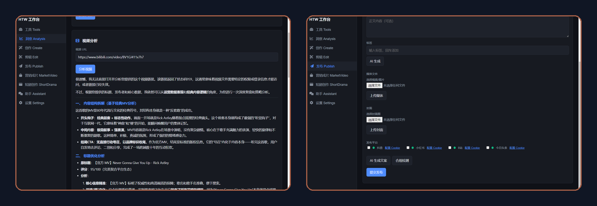

<div align="center">

# HTW Media

### Render a CapCut / JianYing draft to video — without installing CapCut

Point it at a draft folder. The server uploads the assets, renders on JianYing's cloud, and writes the video back next to your draft. Encrypted drafts are decrypted automatically. Batch friendly.

On top of that, the same backend also covers topic research, scripting, editing and one-click publishing to Douyin / Xiaohongshu / Bilibili / Toutiao. The desktop app is a GUI shell over it.

[](https://github.com/HTWMedia/HTWClient/releases/latest)
[](LICENSE)

[中文](README.md) ｜ [Issues](https://github.com/HTWMedia/HTWClient/issues) ｜ [Releases](https://github.com/HTWMedia/HTWClient/releases) ｜ [Web app](https://htwmedia.dpdns.org)

**Keywords**: CapCut draft export · JianYing 剪映 draft render · encrypted draft decrypt · cloud video rendering · batch draft to video · Douyin Xiaohongshu Bilibili auto publish · AI short-video pipeline

</div>

---

## Draft → video in one command

```bash
git clone --depth 1 https://github.com/HTWMedia/HTWClient
cd HTWClient

export HTW_API_KEY="your-key"        # PowerShell: $env:HTW_API_KEY="your-key"

node agent/cli/htw-skills.mjs draft "/path/to/your/draft-folder"
```

```
打包草稿目录 → htw-draft-1793973908448.zip …
  已打包 12 个文件 (86.4 MB)
上传中: htw-draft-1793973908448.zip (86.4 MB) …
已提交，taskId=7655554647196713003
  任务状态: running 42%
  任务状态: completed 100%
下载成片 …
完成: 我的草稿-成片-20261106220513.mp4 (18.2 MB)
```

- Pass a **folder** (it gets zipped, assets and subfolders included) or an already-packed `.zip`.
- Find your draft folder in CapCut: right-click a draft → "Open draft folder". It contains `draft_content.json`.
- Encrypted drafts (default since JianYing 5.9) are decrypted server-side.
- Options: `--out <dir>` · `--no-wait` · `--json`. Exit codes: `0` ok, `1` render failed, `2` bad args, `3` missing key, `4` quota exhausted.

Get a key at <https://htwmedia.dpdns.org> (Settings → create AuthKey). The free tier includes **60 render-minutes per month**, reset monthly; failed tasks are not charged.

---

## Why this instead of the usual draft libraries

1. **It finishes the last mile.** Most open-source JianYing/CapCut tooling stops at *generating* `draft_content.json`; you still have to open CapCut and export manually. This renders the draft to an actual MP4 — no CapCut install, no local GPU.
2. **Then publishes.** Douyin, Xiaohongshu, Bilibili, Toutiao in one submit, with a compliance check before publishing and per-platform retry.
3. **Agent-native.** The same capabilities ship as Agent Skills (`agent/skills/`) so Claude Code / Cursor can orchestrate "research → script → render → publish".

> Sibling project [HDraft](https://github.com/HTWMedia/JyDraft) is the pure-CLI batch version of the same render pipeline (multi-draft concurrency, resumable tasks).

---

## Desktop app (Windows)

[Download the installer or portable exe](https://github.com/HTWMedia/HTWClient/releases/latest). Nine panels: topics, insight, create, marketing video, short drama, edit, publish, tools, assistant.

macOS / Linux: use the web app at <https://htwmedia.dpdns.org> — same account, same quota, same `/api/v2/*` contract.



---

## Tooling

```bash
cd agent/cli
export HTW_API_KEY="your-key"
node htw-skills.mjs list                        # list capabilities
node htw-skills.mjs call insight --hot --dry-run
```

Features: `insight` · `create` · `topics` · `publish` · `tools` · `edit` · `workflow`.
Full CLI reference: [docs/getting-started.md](docs/getting-started.md).

---

## Privacy

- Media is used only while a task is running and deleted afterwards.
- **Platform cookies are uploaded to the server** when you configure publishing — the server posts on your behalf. That is equivalent to handing over your account credentials; only do it if you trust the service, and rotate your passwords afterwards.
- No human reviews your content; everything runs through automation.

## License

[MIT](LICENSE)
