# HTW 工作台 · 图文使用说明

> 本文与本目录下的 11 集教程视频配套制作，内容以视频实际演示为准。
> 每章按「功能点 → 操作步骤 → 使用效果 → 注意事项」展开，可直接按目录跳转查阅。

## 目录

1. [简介与快速上手](#1-简介与快速上手)（必看：AuthKey 配置）
2. [剪辑面板](#2-剪辑面板)（视频粗剪 / 智能包装 / 草稿导出 / 超分 / 解密）
3. [洞察与选题](#3-洞察与选题)
4. [工具](#4-工具)
5. [批量](#5-批量)
6. [营销成片与工作流](#6-营销成片与工作流)
7. [发布与任务中心](#7-发布与任务中心)
8. [短剧创作 / AI 助手 / 创作](#8-短剧创作--ai-助手--创作)
9. [附录：常见提示与注意事项汇总](#9-附录常见提示与注意事项汇总)

---

## 1. 简介与快速上手

### 1.1 这是什么

HTW 工作台是一款面向内容创作者的**一站式创作工具**，覆盖从选题、剪辑、包装到发布的完整创作链路。剪辑、配音、渲染等重活都自动完成，**普通电脑也能流畅出片**。

> **关心数据隐私？** 本项目提供**本地模式**：开启后，大部分处理可以直接放在你自己的电脑上执行。详见 [1.4 本地模式](#14-本地模式可选)。

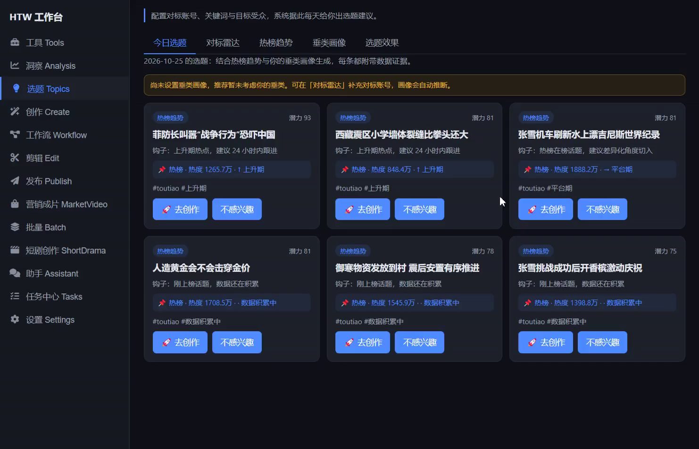

### 1.2 模块导航总览

左侧导航栏从上到下依次是 12 个模块，本文第 2~8 章将逐个讲解：

| 模块 | 用途 |
|---|---|
| 工具 Tools | 语音转写、翻译、总结、歌词提取、人声分离、语音合成、图像生成与识别等创作工具 |
| 洞察 Analysis | 文案 / 视频 / 账号数据分析、热榜、全网搜索 |
| 选题 Topics | 每天推送带数据证据的选题建议 |
| 创作 Create | 把选题、素材和成片方式组织成创作任务 |
| 工作流 Workflow | 串联「选题 → 成片 → 包装 → 发布」全链路 |
| 剪辑 Edit | 粗剪、剪同款、智能包装、草稿导出、超分、解密 |
| 发布 Publish | 一键分发多平台 |
| 营销成片 MarketVideo | 面向电商与本地商家的批量出片 |
| 批量 Batch | 一个模板 × N 条素材 = N 条成片 |
| 短剧创作 ShortDrama | 剧本 → 分集 → 成片的短剧批量生产 |
| 助手 Assistant | 对话式 AI 助手，答疑与内容生成 |
| 任务中心 Tasks | 全模块处理任务实时汇总 |

### 1.3 首次使用：配置 AuthKey（必看）

不配置 AuthKey，所有功能都会被拦截，所以这是使用前的第一步：

1. 点击左下角的 **设置**；
2. 在 **AuthKey** 输入框填入你的密钥（输入框为密码样式，密钥不会明文展示）；
3. 密钥从官网获取：点击 **「前往 web 端获取 AuthKey」** 会自动打开获取页面（可通过邮箱申请，有效期 30 天）；
4. 填入后**自动保存**，状态栏随即显示 **「已设置 ✓」**。

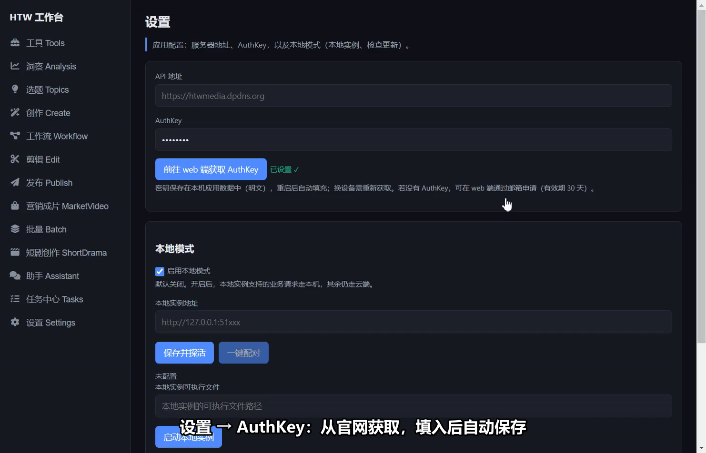

**使用效果**：显示「已设置」后即可使用全部功能；未设置时状态栏显示红色「未设置」并拦截所有操作；修改后状态即时更新。密钥保存在本机应用数据中（明文存储，请留意设备安全），重启后自动填充；换设备需重新获取。

### 1.4 本地模式（可选）

设置面板下方还有**本地模式**：开启后，本地实例支持的业务请求会直接在你自己的电脑上执行，**素材不离开本机**，其余请求仍走在线处理；支持一键配对、保存并探活、启动本地实例、检查更新。

**适合对数据隐私有顾虑、或希望在不依赖在线服务的情况下出片的用户。** 默认不开也无需任何配置，功能开关见设置面板。

> **草稿导出必须开本地模式**：那条链路只在你的机器上执行（渲染用你自己的剪映账号与权益，登录态不出本机），未开启时导出按钮会给出提示而不是提交。

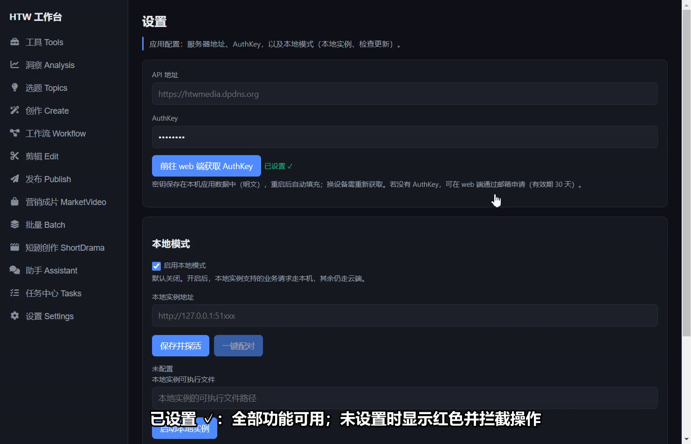

---

## 2. 剪辑面板

剪辑面板是**使用频率最高**的模块，包含六个功能，分工如下：

| 功能 | 作用 |
|---|---|
| 视频粗剪 | 把带口播的长视频自动剪成带配音字幕的成片 |
| 剪同款 | **已下线（2026-11-06）**：模板与素材版权属于剪映及模板作者，本站不再提供 |
| 智能包装 | 一键给视频加字幕、音效、贴纸 |
| 草稿导出 | 把你自己的剪映 / CapCut 草稿包渲染成片（**在本机执行**，需先开本地模式 + 填自己的剪映 Cookie） |
| 超分 | 把低分辨率视频放大到指定分辨率 |
| 解密 | 新版剪映加密草稿 → 明文 JSON |

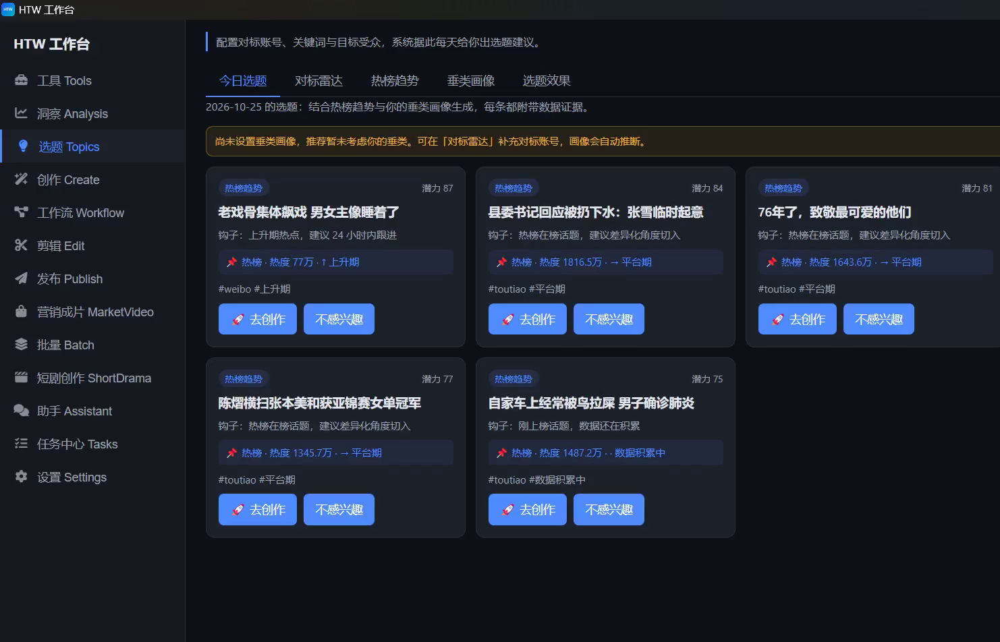

三个「生成」类功能（粗剪、智能包装）负责产出内容，草稿导出负责渲染已有草稿（**在本机执行**），超分负责画质增强，解密负责草稿文件处理。

### 2.1 视频粗剪

**功能点**：把一条带口播的长视频自动剪成成片——解说词和配音基于原片真实语音生成，无需手动剪辑。

**操作步骤**：

1. **选择素材**：点击选择区域，或直接把文件拖进来。注意要选一条**带人声口播**的视频（解说词的事实来源），选中后下方立即显示已选文件名；
2. **设置音色与时长**：在下拉框选择配音音色（清冷女声、纪录片男声、电影男声等），再在「目标时长（秒）」的两个输入框分别填入最短与最长秒数（默认 60～180，教程演示填了 5～60）；如需把原片字幕糊掉，可勾选「模糊原字幕」（模糊后由 AI 重新生成字幕）；
3. **开始粗剪**：提交后依次自动完成语音识别、精彩片段挑选、解说词生成、配音合成与字幕生成，进度条实时显示当前步骤（处理约 5-8 分钟）；
4. **预览与下载**：渲染完成后，结果区直接出现成片播放器和「下载成片」按钮。

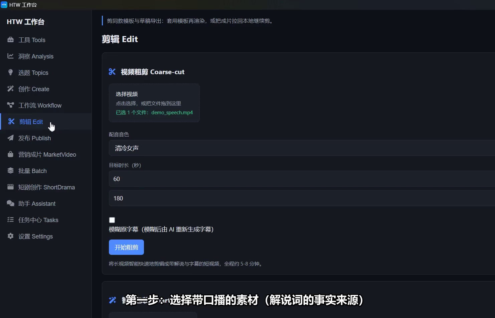

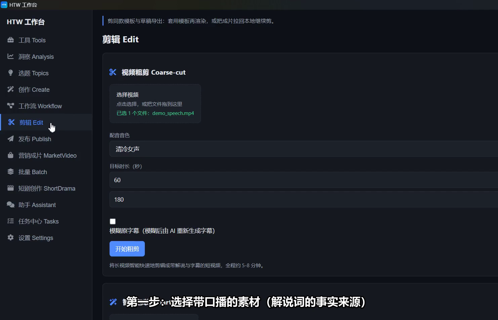

**使用效果**：整条视频不需要手动剪辑，口播、字幕、节奏全部自动生成；可先预览，满意后一键下载。

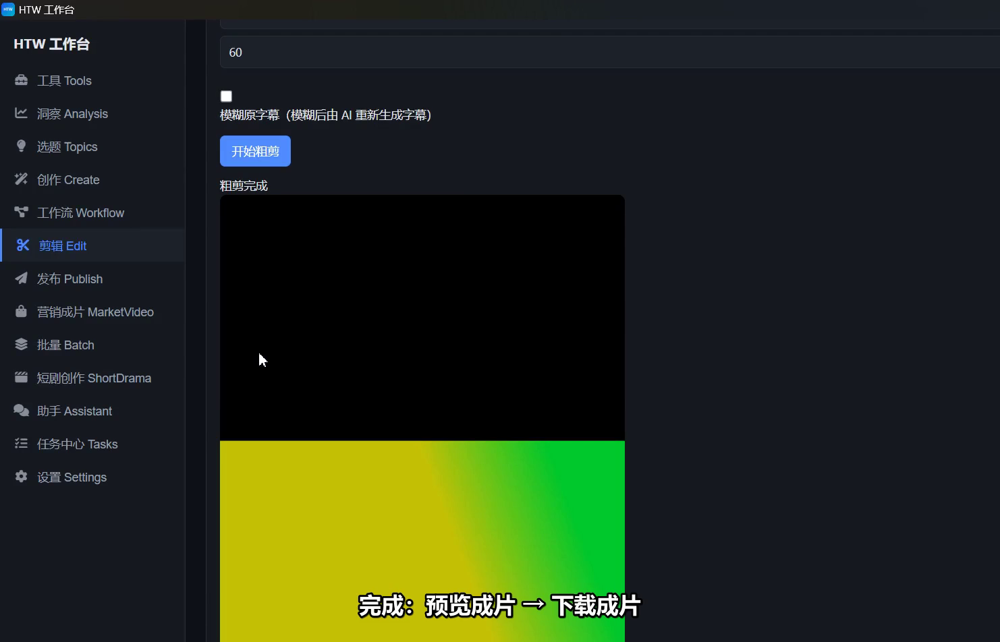

**注意事项**：

- 素材必须含真实人声。纯画面素材会在台词识别/解说词生成阶段被明确告知无法粗剪，并建议改用智能包装或草稿导出；
- 额度不足或服务异常时，结果区会给出具体错误原因，按提示处理即可。

### 2.2 剪同款（已下线）

**已于 2026-11-06 下线，不再提供。** 这个功能要下载剪映的模板包并替换模板作者的素材，模板与素材的版权属于剪映及其模板作者；站外提供同类服务已有生效判决认定构成不正当竞争。

要出片请走两条路：**草稿导出**（渲染你自己的剪映工程）或 **视频粗剪 / 智能包装**（从素材开始）。

### 2.3 智能包装

**功能点**：为视频自动加上字幕、音效、贴纸并突出重点内容，一条素视频一键变成有成品感的视频。

**操作步骤**：

1. 在剪辑面板选择视频（仅支持 mp4 / mov / m4v）；
2. 点击「开始包装」，系统自动分析视频内容并生成包装方案（全程约 3-8 分钟，视视频长度而定）；
3. 完成后结果区出现成片与下载按钮，可预览、可下载。

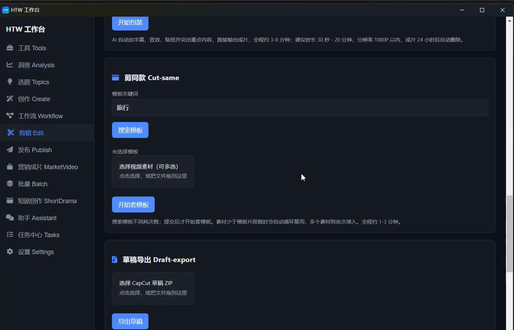

**使用效果**：无需手工加字幕、配音乐，素视频一键获得片头片尾、字幕、贴纸和背景音乐的成品化包装。建议素材时长 30 秒～20 分钟、分辨率 1080P 以内；成片 24 小时后自动删除，注意及时下载。

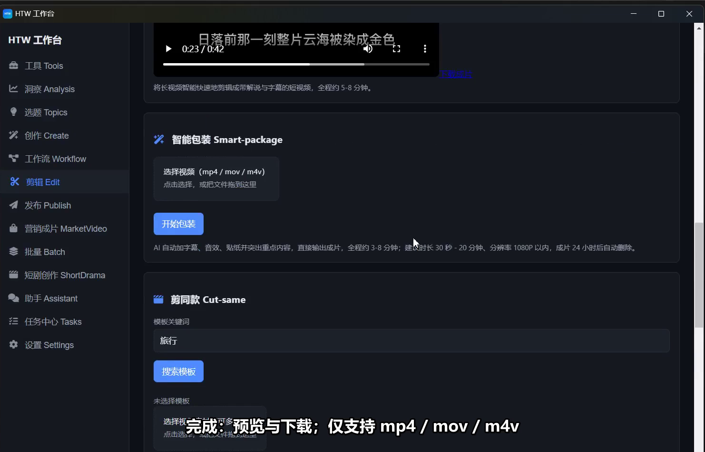

### 2.4 草稿导出

**功能点**：把剪映或 CapCut 生成的草稿包渲染成片——**渲染在你自己的机器上执行，用的是你自己的剪映账号与权益，登录态不出本机**。

> ⚠️ 这一项**必须先开启本地模式**（见 1.4）：云端已不再代跑这条链路，未就绪时点「导出草稿」只会得到一句提示。

**操作步骤**：

1. 设置 → 本地模式：勾选「启用本地模式」→「启动本地实例」→ 等状态显示「本地实例运行中」→「一键配对」到「本地模式就绪」；
2. 在剪辑软件中做好草稿后，准备一个包含 `draft_content` 的草稿 ZIP 包；
3. 回到「剪辑 → 草稿导出」，填入**你自己的剪映登录态 Cookie**（浏览器登录剪映网页版 → 开发者工具 Network → 任一请求头里的整段 Cookie）。填好后点「保存到本机」，下次就不用重填；「清除」即删除本机保存的那一份；
4. 选择草稿 ZIP 并点击「导出草稿」；
5. 提交后系统**先做素材核对**：如果包里缺素材，结果区会明确列出缺失的素材类型、数量和文件名，并说明对应内容会缺失或黑屏——缺素材不会导致任务失败，如需完整画面，把素材文件与 `draft_content.json` 一起打包后重新导出即可；
6. 核对通过的部分继续自动渲染，进度实时可见，完成后直接下载成片。

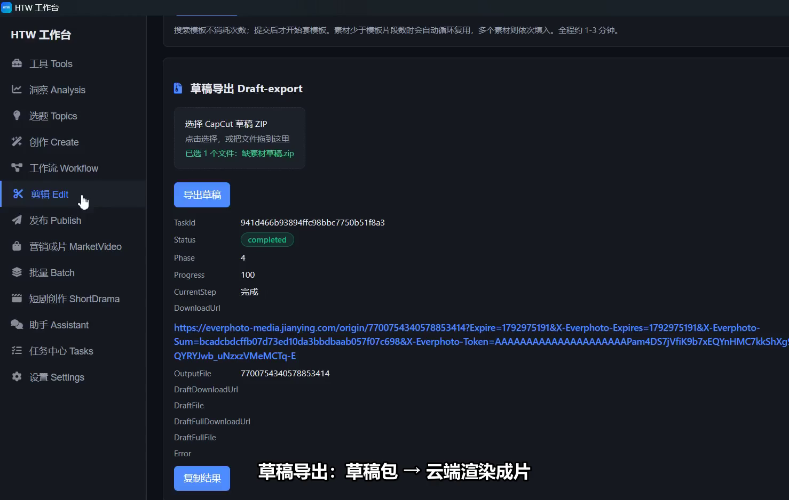

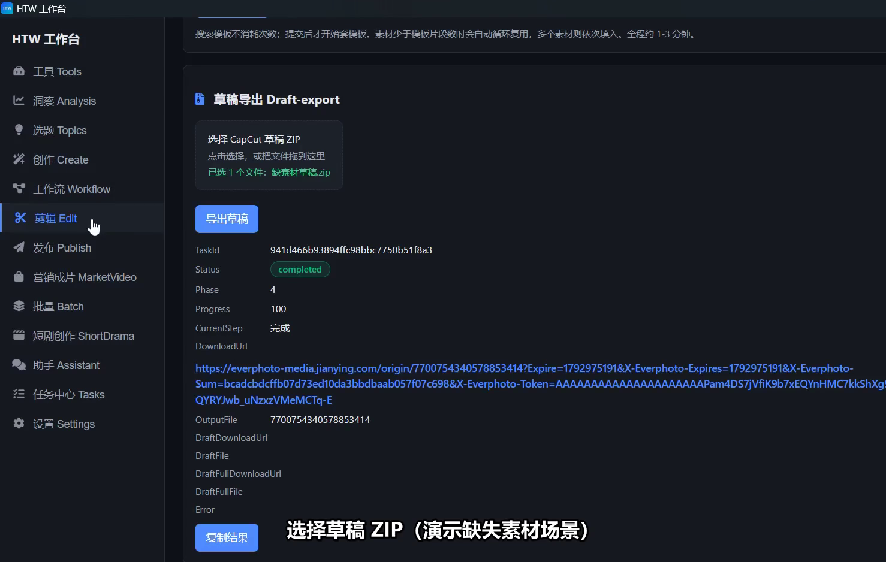

**使用效果**：本地剪好的工程不落地直接出成片，缺什么素材一目了然，补齐重传即可。

**注意事项**：

- **登录态只在本机**：Cookie 明文存在本机的 `userData/htw-jianying.json`（与 AuthKey 同一个目录），不上传本站、服务端不持有；换个账号或登录态过期时重新粘贴一条新的即可；
- **不消耗本站额度**：渲染用的是你自己的剪映权益，本站不计渲染时长；
- 草稿里如果有多条视频轨，**上层轨道的层级要高于主轨**，否则无法渲染，错误信息会给出说明。

### 2.5 超分

**功能点**：把低分辨率视频放大到指定宽高，自动完成画质重建。

**操作步骤**：

1. 选择视频（如一条 960×540 的小视频）；
2. 填写目标宽高（如 1920 × 1080）；
3. 点击「超分」，等待画质重建完成，直接下载成片。

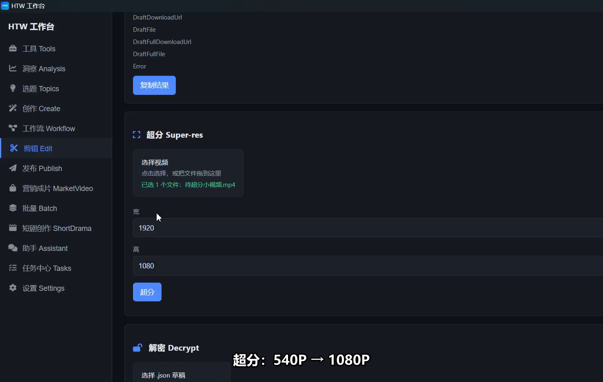

**使用效果**：低清素材一键提升到 1080P 等目标分辨率，成品可直接下载。

### 2.6 解密

**功能点**：新版剪映的草稿 JSON 是加密的，解密功能可把它还原成明文。

**操作步骤**：选择加密的 `draft_content` 文件，点击「解密」，**瞬间返回明文内容**。

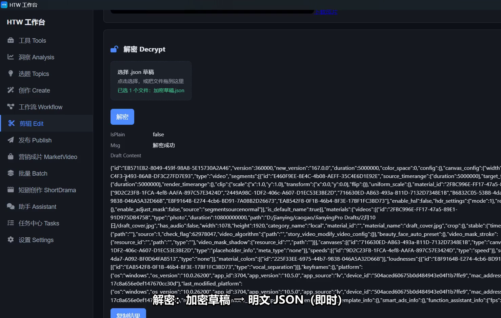

**使用效果**：明文 JSON 可直接查看，或交给其他工具继续处理。

---

## 3. 洞察与选题

### 3.1 洞察 Analysis

**功能点**：创作前的数据分析能力，包含五个工具，以页签切换（文案分析 / 视频分析 / 账号分析 / 热榜 / 全网搜索）：

| 工具 | 输入 | 返回 |
|---|---|---|
| 文案分析 | 粘贴一段文案 | 结构、钩子、情绪点等维度的解读，帮助优化脚本 |
| 视频分析 | 视频链接 URL（仅支持 B 站 / 小红书 / 抖音） | 结构化分析结果 |
| 账号分析 | 账号主页 URL（仅支持 B 站 / 小红书 / 抖音 / 今日头条） | 账号数据分析 |
| 热榜 | 一键获取 | 当前各平台热点榜单，正在上升的话题一目了然 |
| 全网搜索 | 平台（小红书 / B 站 / 抖音 / 头条）+ 关键词 + 数量（1–50） | 相关热门内容列表，用于对标调研；抖音 / 头条返回搜索页链接 |

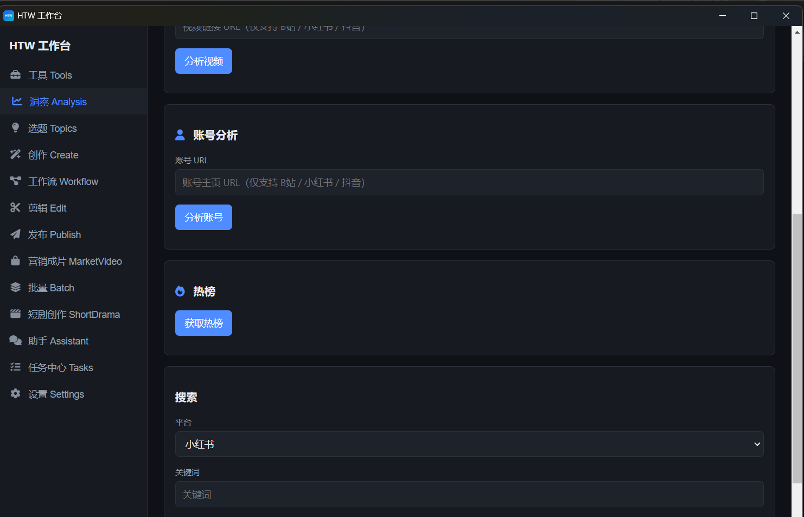

**使用效果**：输入链接或文案即可获得结构化分析结果，先调研再动手，选题和脚本都有依据。

### 3.2 选题 Topics

**功能点**：系统**每天**结合热榜趋势与你的垂类画像，自动生成选题建议。

**使用效果与说明**：

- 每条选题建议都带**数据证据**，不是凭空推荐；
- 点击 **「去创作」** 可以带着选题直接进入创作流程；
- 界面上的黄条提示会提醒你补充对标账号——**画像会随着使用越来越准**，选题也会越来越贴合你的垂类。

---

## 4. 工具 Tools

**功能点**：创作工具箱，全部自动执行、按需取用：

| 工具 | 用途 |
|---|---|
| 语音转写 | 音频 / 视频转文字稿（支持普通文本等转写格式，可勾选「对齐文本」返回带时间信息的结果） |
| 翻译 | 文本翻译 |
| 总结 | 把音频 / 视频内容自动总结成要点摘要 |
| 歌词提取 | 从音频中提取歌词 |
| 人声 / 伴奏分离 | 分离人声与伴奏（可选分离类型） |
| 语音合成 TTS | 文本转语音，可选择发音人（清冷女声等音色） |
| 图像识别 | 上传图片，返回内容的详细描述 |
| 图像生成 | 输入描述文字，直接生成图片 |
| 字幕提取 | 从视频中提取字幕 |
| 模板搜索 | 按关键词搜索剪映云模板，配合剪同款使用 |

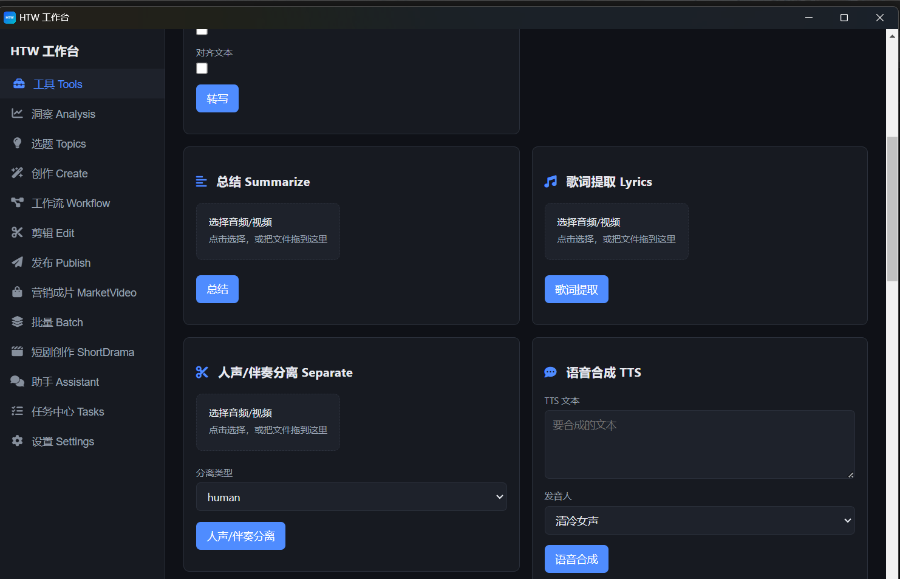

**操作步骤**：所有工具都是同一套用法——**选文件（或输入文本）→ 点按钮 → 等结果**，没有任何学习成本。

**使用效果**：转写拿文字稿、总结拿要点、识别与生成做封面素材，都是即取即用的单点能力。

---

## 5. 批量 Batch

**功能点**：解决「一个模板跑 N 条视频」的问题，支持**批量剪同款、批量智能包装、批量营销成片**三种批次类型。

**操作步骤**：

1. 选择批次类型；
2. 搜索并选择模板（与剪同款面板一致）；
3. 批量选择素材文件（营销成片批次还可填写商品条目：一行一个，格式「商品名|卖点|优惠活动」，商品素材可整批共用，视频素材每个文件 = 一条）；
4. 点击「提交批次」，系统创建批次任务，N 条素材由**后台队列并行处理**，互不阻塞。

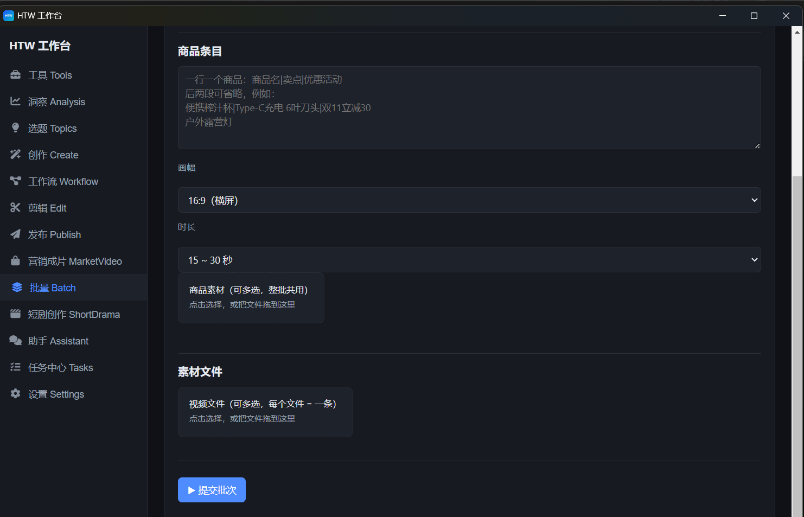

**使用效果**：提交后点击「批次状态」，可以看到每一批的进度、成功数量和失败原因；批次粒度的状态与单条任务分开管理，互不影响。

**注意事项**：

- 批量能力对**账号档位**有要求，免费档提交会被拒绝并返回明确提示；
- 素材数量、模板可用性的校验规则与单个剪同款一致。

---

## 6. 营销成片与工作流

### 6.1 营销成片 MarketVideo

**功能点**：面向电商与本地商家的批量出片面板：填商品信息，自动生成营销口播成片。

**操作步骤**（四步配置，批量启动）：

1. 选择批次类型；
2. 选择模板；
3. 填写商品条目（一行一个商品，格式「商品名|卖点|优惠活动」，后两段可省略，如只写「户外露营灯」）；可用 **「生成卖点」** 自动生成核心卖点、**「AI 生成口播」** 自动撰写营销口播文案；
4. 选择素材文件，配置画幅（16:9 横屏 / 9:16 竖屏）、时长（15-30 秒）、优惠活动、适用人群后，点击「生成成片」批量启动。

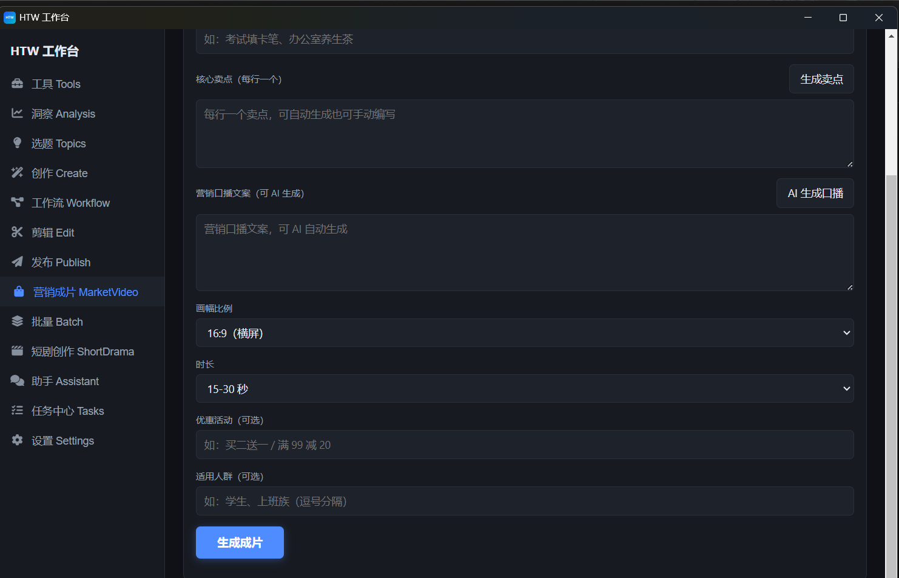

**使用效果**：每个商品一条成片，口播文案、卖点、节奏全部自动生成，适合商品多、上新快的商家批量出片。

### 6.2 工作流 Workflow

**功能点**：全链路自动化——把选题、创作、发布串成自动流水线，一次配置按计划跑。支持四种内容形态：**视频成片、口播解读、图文文章、微头条**（视频成片的完整链路为：AI 出片 → 智能包装 → 文案 → 发布）。

**操作步骤**：

1. 选择内容形态；
2. 填入选题主题，或点 **「让系统选题」**；
3. 勾选发布平台（抖音 / 小红书 / B 站 / 今日头条）；
4. 点击「开始工作流」，任务进入处理队列，各阶段进度在面板与任务中心同步展示。

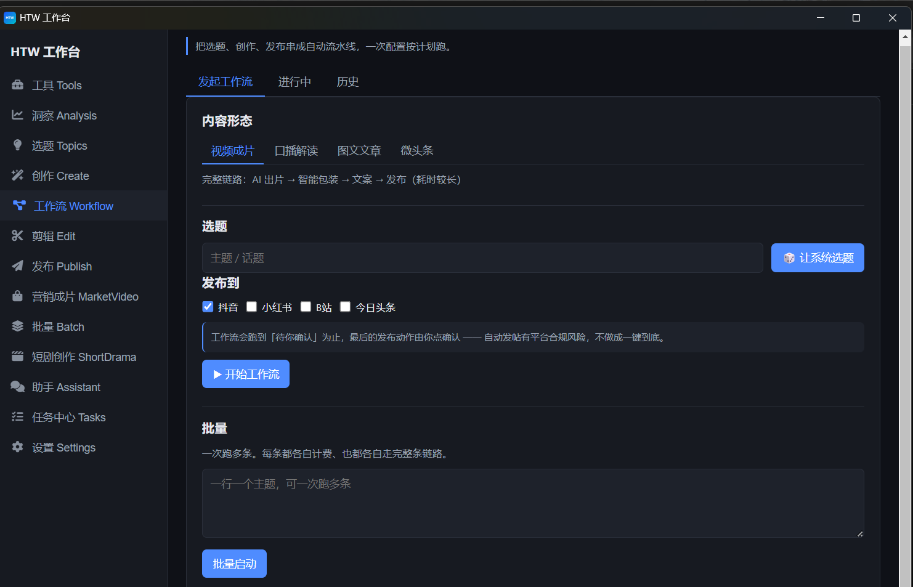

**使用效果**：一次配置跑完整条创作链路；支持批量模式（一行一个主题，一次跑多条，每条各自计费、各自走完整条链路）。

**注意事项**：

- **工作流会跑到「待你确认」为止**——最后的发布动作由你手动确认，不做一键到底，避免自动发帖的平台合规风险；
- 工作流耗时长，建议提交后到任务中心盯进度。

---

## 7. 发布与任务中心

### 7.1 发布 Publish

**功能点**：管理内容分发，共四个页签：**发布编辑、任务队列、历史记录、Cookie 配置**。

**操作步骤**（发布编辑页签）：

1. 填入标题，点击 **「AI 生成」** 自动撰写文案（正文、标签均可生成）；
2. 上传媒体与封面（视频 / 图片可多选）；
3. 配置目标平台的 Cookie；
4. 提交发布，任务进入任务队列。

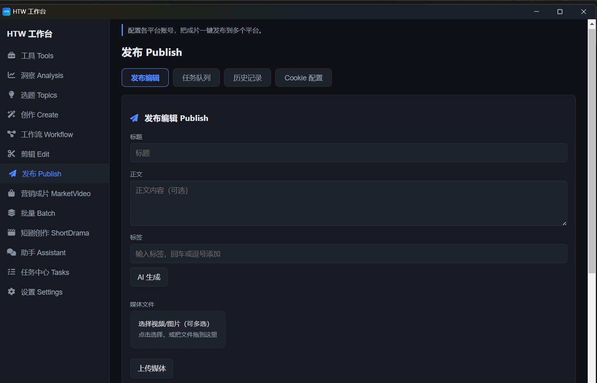

**使用效果**：一个面板管所有平台的分发：任务队列与历史记录管理所有分发任务；Cookie 配置集中维护各平台登录状态。发布前可对文案跑**合规检测**，Cookie 失效会有明确的重新配置提示。

### 7.2 任务中心 Tasks

**功能点**：实时汇总所有模块的处理任务，按「进行中 / 已完成 / 失败」分组展示。

**使用效果**：

- **实时推送**，无需手动刷新；
- 失败的任务会显示具体失败原因，并提供「回到面板」「重试」按钮；
- 已完成的任务可直接「下载」，或「回到面板」查看结果；
- 已结束的记录可一键清空（含失败）。

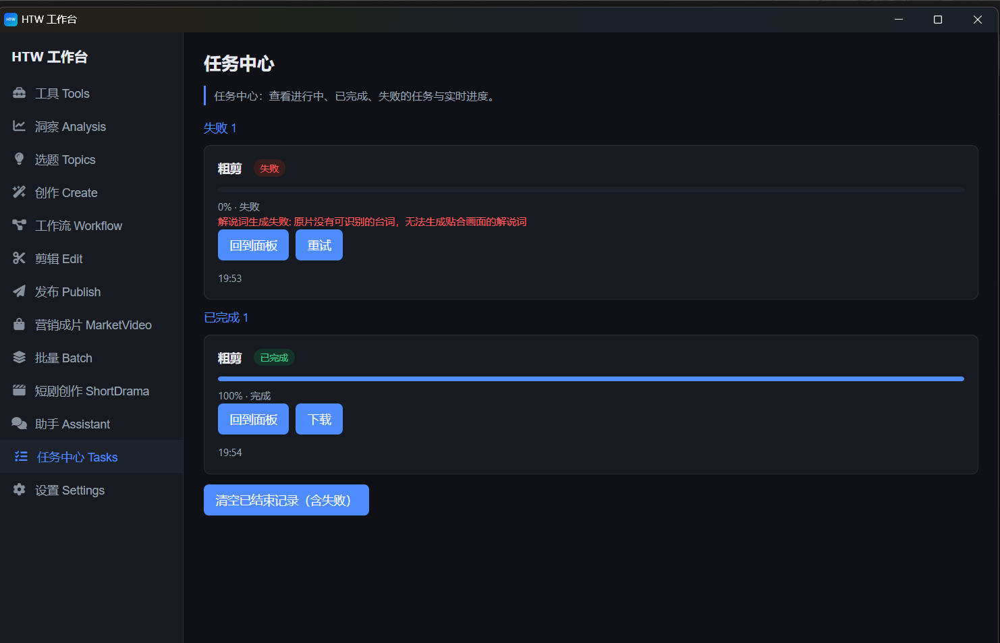

---

## 8. 短剧创作 / AI 助手 / 创作

### 8.1 短剧创作 ShortDrama

**功能点**：面向短剧赛道的批量生产面板，从**剧本、分集到成片**按流程走，自动渲染：设定角色与分镜，自动生成短剧成片。

**操作步骤**：

1. 填写视频主题描述（必填，如「30 岁职场逆袭短剧，女主从普通文员成长为总监」）；
2. 配置画幅（9:16 竖屏）、脚本长度（中，约 60 秒）、视频风格、画面风格（真实高画质）、生成模式（快速）；
3. 「动态镜头」可选 AI 生成真视频（默认关闭：静态图 + 运镜；仅开头几个镜头生成真视频，较慢，失败会自动回退，不影响成片）；
4. 点击「开始生成」。

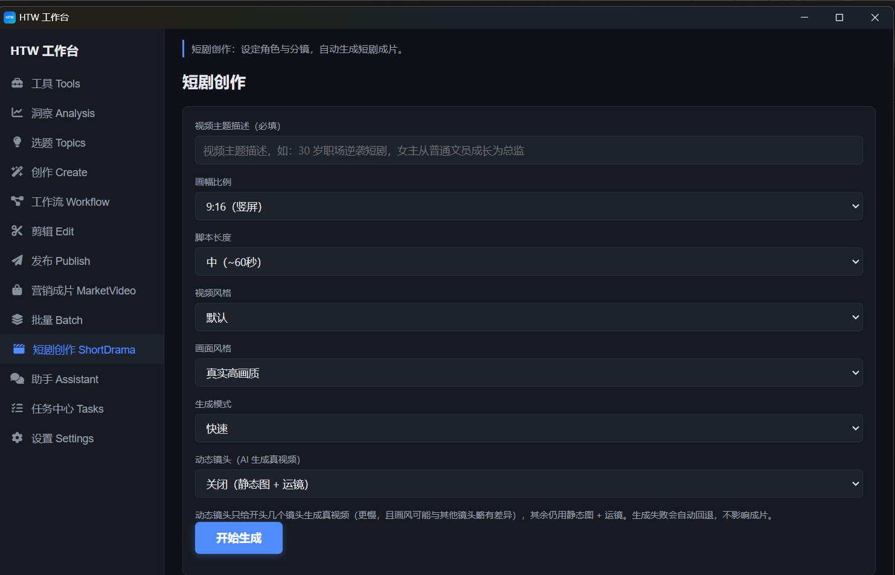

**使用效果**：无需拍摄，从主题描述直接产出带分集结构的短剧成片。

### 8.2 AI 助手 Assistant

**功能点**：对话式创作助手——视频 / 图片 / 文章创作与发布，用聊天的方式完成。

**操作步骤**：直接对话提问，或点击顶部功能标签（语音转写、语音合成、视频创作、图片创作、文章创作、发布、Cookie 配置、洞察、剪辑、选题、智能体、工具）快速了解某个功能。

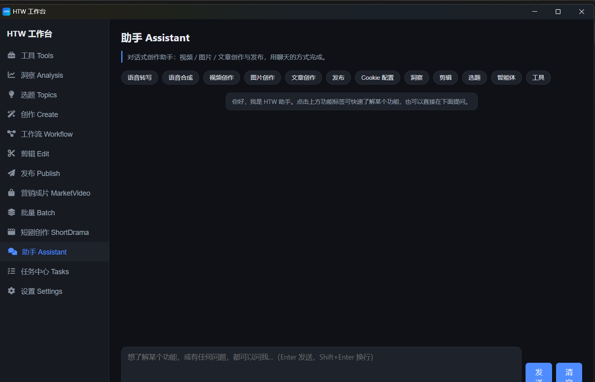

**使用效果**：可以问使用问题、生成文案或选题建议，回答流式返回。例如让它「起三个秋天旅行视频的标题」，几秒钟就给出结果。

### 8.3 创作 Create

**功能点**：AI 创作工作台——承接选题面板的「去创作」，从选题到图文 / 视频成片，可上传素材、分步开关每道工序。含**视频创作、图片创作、文章创作**三类。

**操作步骤**：

1. 输入创作主题 / 创意描述；
2. 选择视频类型（口播/知识博主、知识科普、带货种草、剧情短剧、Vlog 生活、新闻资讯、教程讲解、情感故事、企业宣传，共 9 种人设模板）；
3. 可填写参考视频链接（每行一个）、上传素材；
4. 按工序推进直到成片。

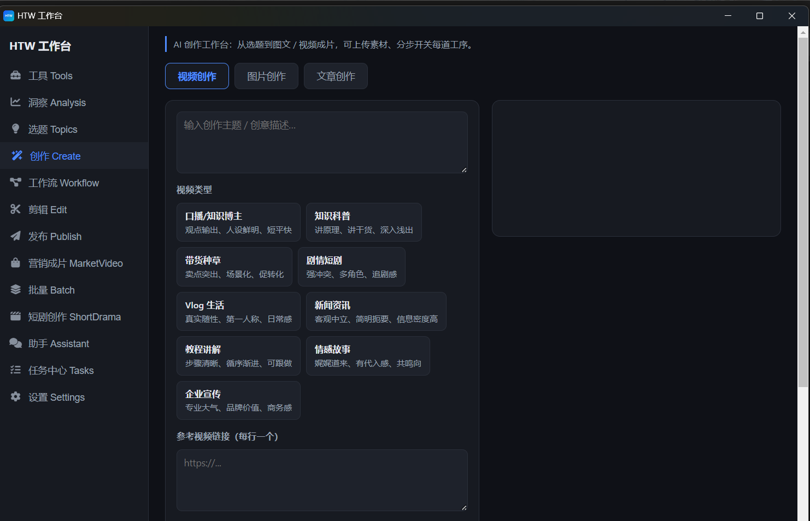

**使用效果**：选题 → 创作任务一键流转，不同内容类型有对应的人设与结构模板，成片方式可分步控制。

---

## 9. 附录：常见提示与注意事项汇总

| 场景 | 提示与处理 |
|---|---|
| 未配置 AuthKey | 状态栏红色「未设置」，所有功能被拦截 → 到「设置」填入密钥 |
| AuthKey 过期 / 换设备 | 密钥有效期 30 天，换设备需重新获取；可在 web 端通过邮箱申请 |
| 粗剪素材没有人声 | 台词识别阶段明确告知无法粗剪 → 改用智能包装或草稿导出 |
| 粗剪 / 剪同款 / 包装失败 | 结果区显示具体原因（如「素材缺失」「额度不足」），按提示处理 |
| 智能包装 / 剪同款格式不支持 | 仅支持 mp4 / mov / m4v |
| 剪同款模板不可用 | 付费或未解锁模板无法套用，选择时注意卡片上的可用状态 |
| 草稿导出提示缺素材 | 结果区列出缺失类型、数量和文件名；缺素材不会导致失败，把素材与 draft_content.json 一起打包重传，否则对应内容会缺失或黑屏 |
| 草稿导出拒绝渲染 | 多视频轨时上层轨道层级须高于主轨 → 把上层视频轨的相对层级调高后重新导出草稿包 |
| 批量提交被拒绝 | 批量能力需要相应账号档位，免费档会返回明确提示 |
| 发布 Cookie 失效 | 明确提示重新配置 → 到「Cookie 配置」页签更新登录状态 |
| 渲染等待 | 粗剪约 5-8 分钟、包装约 3-8 分钟，均为自动处理；本机无需高性能配置 |
| 不知道功能在哪用 | 问「助手」，或看配套教程视频（本目录 out/ 下共 11 集） |

---

## 配套教程视频

视频以 GitHub Release 附件分发，点击直达；全套索引与制作说明见 [README.md](README.md)。

| 视频 | 时长 | 内容 |
|---|---|---|
| [01 安装与初始配置](https://github.com/HTWMedia/HTWClient/releases/download/v0.5.0/01-setup.mp4) | 1:59 | AuthKey 配置、本地模式 |
| [02 剪辑 · 视频粗剪](https://github.com/HTWMedia/HTWClient/releases/download/v0.5.0/02-coarse-cut.mp4) | 2:28 | 粗剪完整过程 |
| [03 剪辑 · 剪同款](https://github.com/HTWMedia/HTWClient/releases/download/v0.5.0/03-cutsame.mp4) | 1:18 | ⚠️ 该功能已下线（2026-11-06），本集仅作历史留存，请勿照做 |
| [04 剪辑 · 智能包装](https://github.com/HTWMedia/HTWClient/releases/download/v0.5.0/04-smart-pack.mp4) | 0:53 | 一键包装 |
| [05 剪辑 · 草稿导出 / 超分 / 解密](https://github.com/HTWMedia/HTWClient/releases/download/v0.5.0/05-draft-sr-decrypt.mp4) | 1:44 | ⚠️ 草稿导出的流程已改（现在需要先开本地模式、填自己的剪映 Cookie），以本文 2.4 节为准 |
| [06 洞察与选题](https://github.com/HTWMedia/HTWClient/releases/download/v0.5.0/06-insight-topics.mp4) | 1:00 | 数据分析与每日选题 |
| [07 工具](https://github.com/HTWMedia/HTWClient/releases/download/v0.5.0/07-tools.mp4) | 0:49 | 创作工具箱演示 |
| [08 批量](https://github.com/HTWMedia/HTWClient/releases/download/v0.5.0/08-batch.mp4) | 0:51 | 批量出片 |
| [09 营销成片与工作流](https://github.com/HTWMedia/HTWClient/releases/download/v0.5.0/09-marketflow.mp4) | 0:46 | 电商批量出片、全链路工作流 |
| [10 发布与任务中心](https://github.com/HTWMedia/HTWClient/releases/download/v0.5.0/10-publish-tasks.mp4) | 0:56 | 多平台分发、任务汇总 |
| [11 短剧 · 助手 · 创作 · 总结](https://github.com/HTWMedia/HTWClient/releases/download/v0.5.0/11-shortdrama-assistant.mp4) | 1:07 | 短剧创作、AI 助手、创作、全系列总结 |

> 建议阅读顺序与视频观看顺序一致：先看第 1 章（AuthKey 必配），再按 2 → 3 → 4 → 5 → 6 → 7 → 8 依次了解各模块。
